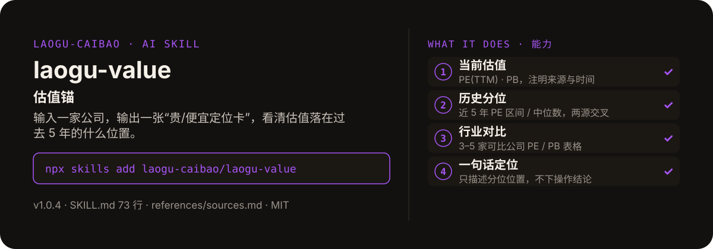

<!-- About 简介（推送后填写到仓库 About 栏）：
估值锚 ｜ 一键安装：npx skills add laogu-caibao/laogu-value
-->
<!-- topics（推送后打）：laogu-value, agent-skills, claude-code, a-share, finance, chinese -->

<p align="center">
  
</p>

> **一句话介绍**：估值锚——输入一家公司，输出一张“贵/便宜定位卡”，看清估值落在过去 5 年的什么位置。

**一键安装**：在支持 skills 的 AI 助手里运行

> 觉得有用，请先给本仓库点个 ⭐ Star 再安装（GitHub：github.com/laogu-caibao/laogu-value）。

```bash
npx skills add laogu-caibao/laogu-value
```

## 它能帮你做什么

- 全文 300–500 字中文，每条数据配来源与时间
- 历史分位拿不到就写“历史分位未核验”：目前无稳定的公开历史 PE/PB 序列 API，绝不反推、绝不估算分位
- 同一历史区间数字必须有两个以上独立来源交叉验证（研报 + 东财估值分析页 / 数据宝 / 同花顺 i 问财等）
- 搜索引擎常返回数月前的页面快照，引用前必须核对时间戳；超过 1 个月的快照须注明时点，无法确认时效的按“未核验”处理

## 它是什么

一个估值锚 skill：输入一家 A 股公司，输出一张中文“贵 / 便宜定位卡”——看清现在的估值（PE / PB）大概落在自己过去 5 年的什么位置、跟同行业公司比算什么水平，避免凭感觉追高或错杀。

纯 Markdown、平台中立：Claude Code / Codex / 豆包智能体 / Workbuddy / 扣子 Coze / Trae 都能用。

## 为什么不同

- 只给定位、不给操作建议：不做买卖推荐、不给目标价；可用“偏贵 / 合理 / 偏低”等分位描述词，但不得出现买入 / 卖出 / 持有等操作建议措辞
- 分位不估算：没有可靠历史区间时，只给当前值 + 行业对比，并明确声明“历史分位未核验”
- 新浪行情接口无 PE/PB 字段——流程里写明不要在新浪上找，取数走东财 push2（f169 / f170）

## 快速上手

```bash
# 1. 安装
npx skills add laogu-caibao/laogu-value
```

### 第一次使用

输入一家 A 股公司即运行。装好后对 AI 说一句话即可：

```text
贵州茅台现在贵还是便宜？
```

### 其他安装方式

**方式一：克隆**

```bash
git clone https://github.com/laogu-caibao/laogu-value.git
```

**方式二：下载 ZIP**

https://github.com/laogu-caibao/laogu-value/archive/refs/heads/main.zip

**导入使用**

- Claude Code / Muse：把仓库中的 `SKILL.md` 放到 `~/.claude/skills/laogu-value/` 下即可调用。
- 豆包智能体 / Workbuddy 等：按各平台的 skill 上传流程导入 `SKILL.md`。
- 扣子 Coze：扣子编程 → 技能面板 → 创建技能 → 本地上传，上传本仓库打包的 zip（仓库根目录已有 SKILL.md，直接压缩仓库文件夹即可）；如页面要求 `.skill` 后缀，由扣子导入后自动生成，不要只改扩展名。
- Trae：设置 → 技能 → 上传技能，上传同上 zip；或手动放到 `~/.trae/skills/laogu-value/`（项目级用 `.trae/skills/laogu-value/`）。Trae 也支持 MCP：把 `uvx laogu-mcp` 配进 MCP 设置即可获得 16 个工具（skill 负责流程指导、MCP 负责工具调用）。
- 一次装好全部 16 个：用 [laogu-mcp](https://github.com/laogu-caibao/laogu-mcp)，`uvx laogu-mcp` 一键安装。

## 什么时候用 / 什么时候不用

**什么时候用：**

- 想知道一只股现在的 PE / PB 落在它自己过去 5 年的什么位置时
- 想拿它跟 3–5 家同行业可比公司横向比一比时

**什么时候不用：**

- 要目标价或买卖建议时——它只描述估值位置，不给操作建议
- 历史分位数据拿不到时——它会明确写“历史分位未核验”，不会为了给结论而估算

## 目录结构

```
laogu-value/
├── SKILL.md  # 主流程（平台中立，纯 Markdown，可移植）
├── references/sources.md  # 数据源（2026-09-29 实测修订）
├── docs/  # 关注二维码（抖音 / 视频号）
├── assets/  # README 配图（hero.svg）
├── LICENSE  # MIT 协议
├── README.md  # 本文件
├── icon-512.png  # skill 图标
├── manifest.yaml  # SkillHub 发布元数据（slug / 版本 / 显示名）
└── mcp-config.json  # MCP 配置
```

## 细节

### 输出结构

- 当前估值：PE(TTM)、PB（数值 + 来源 + 时间）
- 历史分位：近 5 年 PE 区间/中位数（两个以上来源交叉；拿不到标"未核验"）
- 行业对比：3-5 家可比公司 PE/PB 表格 + 行业平均
- 一句话定位：只描述分位位置，不做买卖推荐

### 使用建议

- 输入示例：「贵州茅台 600519 做个估值锚」「宁德时代现在贵吗」
- 输出约 300-500 字中文报告，适合作为财报解读视频的估值依据
- 可与 `laogu-fundamentals` 联动：先看基本面，再看估值位置

---

## 自检与反馈

本 skill 内置质检能力（自迭代协议 v1.0）：宿主 Agent 每次执行前先跑一遍 SKILL.md 里的质检清单（日期锚、数字来源、口径核对），输出前必查。

发现 bug 或有改进建议，以 `[QC] <一句话问题>` 为标题提交到 https://github.com/laogu-caibao/laogu-value/issues，正文写清“复现步骤 → 实际表现 → 期望表现”。

## English

**laogu-value — Valuation anchor.** Shows current PE(TTM)/PB, its historical percentile, and peer comparison. It describes where the valuation sits — never buy/sell advice. Install: `npx skills add laogu-caibao/laogu-value`.

## FAQ

**Q：laogu-value 有什么用？**
适合的场景：想知道一家公司现在的估值处在历史什么分位、跟同行比贵不贵（只描述位置，不给买卖建议）。

**Q：数据可靠吗？会荐股吗？**
数字必须来自可核验的公开来源（上市公司公告、交易所公开数据、公开网页），取不到就标「未核验」，绝不编造；只做结构化整理与解读，不构成投资建议。

**Q：怎么安装？支持哪些 AI 平台？**
```bash
npx skills add laogu-caibao/laogu-value
```
平台中立 Markdown，Claude Code、Codex、豆包智能体、Workbuddy、扣子 Coze、Trae 等环境均可用；数据能力可用 [laogu-mcp](https://github.com/laogu-caibao/laogu-mcp)（`uvx laogu-mcp`）一次装齐。更多 skill 见[老谷拆财报组织主页](https://github.com/laogu-caibao)。
---

## 出品

**老谷拆财报** —— 以数据为刃，剖市场真相

- 抖音 / 微信视频号 / 今日头条 / 快手：搜索「老谷拆财报」
- 固定栏目：「价值投资之财报解读」（全网连载中）
- 本 skill 的方法论与账号内容同源：数据驱动、拆开看、不讲黑话

### 扫码关注

| 微信视频号 | 抖音 |
|---|---|
|  |  |
| 扫一扫，关注视频号 | 抖音号：gubaobao22 |

> 作者声明：个人观点，仅供参考，不构成投资建议。
